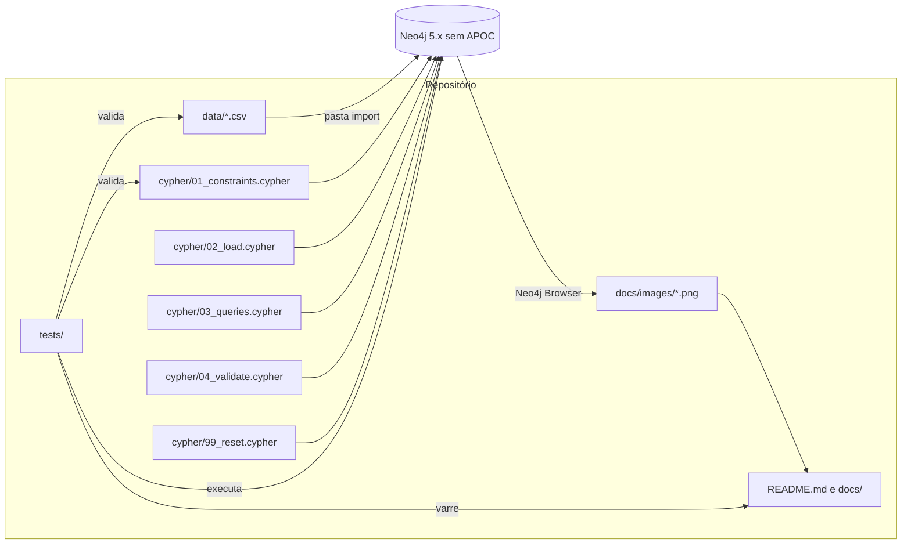
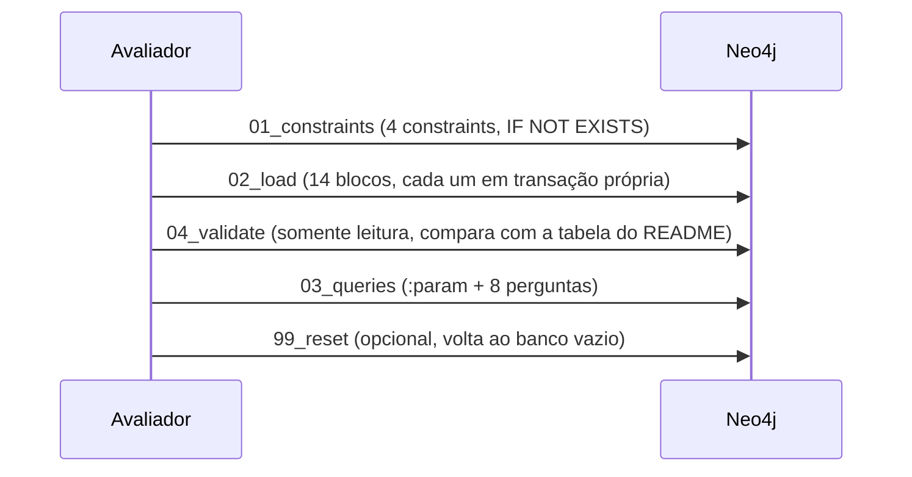
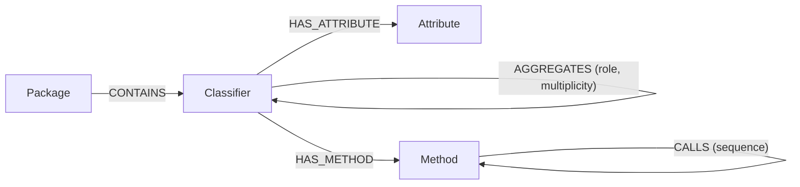

# Design Document

## Overview

Este documento descreve o design do repositório de portfólio **neo4j-uml-graph-portfolio**. O repositório modela um diagrama de classes UML de um sistema de e-commerce como um grafo no Neo4j 5.x (sem APOC) e demonstra, com consultas Cypher, perguntas de arquitetura que são naturais em grafo: herança transitiva, análise de impacto, detecção de ciclos de dependência, violação de camadas, acoplamento e cadeia de chamadas.

O produto é composto por artefatos estáticos (CSVs, scripts Cypher, documentação, imagens) e por uma suíte de testes automatizados que verifica a coerência desses artefatos e o comportamento dos scripts em uma instância real do Neo4j.

### Decisões de modelagem já tomadas

| Decisão | Escolha |
|---|---|
| Labels de nó | `Package`, `Classifier` (com labels secundários `Class`, `Interface`, `Enum`), `Attribute`, `Method` |
| Tipos de relacionamento | `CONTAINS`, `HAS_ATTRIBUTE`, `HAS_METHOD`, `EXTENDS`, `IMPLEMENTS`, `DEPENDS_ON`, `ASSOCIATES`, `COMPOSED_OF`, `AGGREGATES`, `CALLS` |
| Propriedades de relacionamento | `role` e `multiplicity` em `ASSOCIATES`, `COMPOSED_OF` e `AGGREGATES`; `sequence` em `CALLS` |
| Carga | Cypher nativo, sem APOC, um bloco `LOAD CSV` por tipo de relacionamento, sempre com `MERGE` |
| Dataset obrigatório | Um ciclo de dependência e a violação `Payment -> StripeGateway` (pacote `domain` dependendo de `infra`) |
| Scripts | `01_constraints`, `02_load`, `03_queries`, mais validação e reset numerados |

### Pontos em aberto identificados na análise dos requisitos

Estes pontos não bloqueiam o design, mas pedem uma decisão do Autor. O design adota a opção indicada em cada linha.

| # | Ponto | Opção adotada neste design |
|---|---|---|
| 1 | O Requirement 3.4 manda executar a validação (3º) antes das consultas (4º), mas o Requirement 1.2 diz que o prefixo `NN` indica a ordem de execução crescente, e o Requirement 9 fixa `03_queries.cypher`. | Os arquivos são `01_constraints`, `02_load`, `03_queries`, `04_validate` e `99_reset`. A validação é somente leitura. O README recomenda executá-la logo após a carga. Sugere-se ajustar o texto do Requirement 3.4 ou 1.2 para eliminar a contradição. |
| 2 | O Requirement 6.1 exige uma constraint por label do Modelo_Grafo, mas `Class`, `Interface` e `Enum` são labels secundários sem identificador próprio. | O Modelo_Grafo distingue "labels base" (`Package`, `Classifier`, `Attribute`, `Method`, com identificador único) de "labels derivados" (`Class`, `Interface`, `Enum`, calculados a partir de `Classifier.kind`). São criadas exatamente 4 constraints. Sugere-se explicitar essa distinção no Requirement 6.1. |
| 3 | O Requirement 5.2 e a introdução afirmam que `data/classifiers.csv` existe com 16 classificadores, mas o arquivo não está no disco (a pasta `data/` está vazia). | O design define o conteúdo do dataset (seção Data Models) como proposta a ser criada e validada na etapa de implementação. |
| 4 | O Requirement 12.1 proíbe o termo em "documentos", mas o `requirements.md` precisa citar o termo para defini-lo. | A varredura de termos proibidos exclui `.git/` e `.kiro/`. Este design não escreve o termo. |
| 5 | O Requirement 3.6 diz que o Script_Reset remove também as constraints, e o Requirement 7.9 fala apenas de nós e relacionamentos. | O `99_reset` remove nós, relacionamentos e as 4 constraints do projeto, em dois estágios separados por comentário. |

## Architecture

O repositório não tem servidor de aplicação. A "arquitetura" é o fluxo entre dados, scripts, o banco e as evidências.



### Estrutura de pastas

```
Neo4j_UML/
  README.md
  LICENSE
  .gitignore
  data/
    classifiers.csv
    relationships.csv
    attributes.csv
    methods.csv
    calls.csv
  cypher/
    01_constraints.cypher
    02_load.cypher
    03_queries.cypher
    04_validate.cypher
    99_reset.cypher
  docs/
    modelo-grafo.md
    images/
      schema-db.png              (db.schema.visualization())
      schema-arrows.png          (Arrows.app)
      schema-arrows.json         (exportação do Arrows.app)
      q01-...png a q08-...png    (evidências visuais)
  tests/
    requirements-dev.txt
    conftest.py
    helpers/                     (gerador de dataset sintético, oráculos, validador)
    test_*.py
```

A pasta `tests/` é um acréscimo ao Requirement 1.1. Ela não conflita com ele, que lista apenas as pastas mínimas.

### Fluxo de execução dos scripts



### Decisões de design e justificativas

1. **Um bloco por tipo de relacionamento.** O Cypher não aceita tipo de relacionamento dinâmico em `MERGE` sem APOC. Um bloco por tipo, cada um filtrando `WHERE row.type = '<TIPO>'`, resolve isso com Cypher nativo e mantém cada bloco curto e comentável (Requirement 7.5 e 7.6).
2. **Scripts de uma instrução por bloco, em transações separadas.** O Neo4j Browser e o `cypher-shell` executam instruções separadas por `;` em sequência, cada uma em sua transação, e param no primeiro erro. Isso produz exatamente o comportamento exigido no Requirement 7.8: o que já foi gravado permanece, e uma nova execução completa o grafo por `MERGE`.
3. **`MERGE` pelo identificador, `SET` para as demais propriedades.** `MERGE (c:Classifier {id: row.id}) SET c.name = ...` evita duplicar nós quando uma propriedade não identificadora muda. Nos relacionamentos, `MERGE (a)-[r:TIPO]->(b)` usa só os dois extremos e o tipo, e `role`, `multiplicity` e `sequence` entram por `SET`. Isso garante idempotência mesmo se o dataset for editado.
4. **Labels secundários sem APOC.** `FOREACH (_ IN CASE WHEN row.kind = 'class' THEN [1] ELSE [] END | SET c:Class)` aplica `Class`, `Interface` ou `Enum` a partir de `kind`, em Cypher nativo.
5. **Conversão de tipos com funções `OrNull`.** `toBooleanOrNull()` e `toIntegerOrNull()` retornam nulo para valor vazio ou não conversível, sem lançar erro e sem gravar a string original. Isso atende o Requirement 7.3 e 7.4.
6. **Linhas com chave nula são descartadas explicitamente.** `LOAD CSV` entrega campo vazio como nulo, e `MERGE` com chave nula é erro. Cada bloco começa com `WITH row WHERE row.id IS NOT NULL`, para não interromper a importação das demais linhas.
7. **Referência não resolvida não gera nó órfão.** Nos blocos de relacionamento, `MATCH` dos dois extremos antes do `MERGE` descarta silenciosamente a linha cujo extremo não existe. O risco é perda silenciosa de dados. A mitigação é dupla: o validador de dataset (testes) garante 100% de referências resolvidas, e o `04_validate` compara as contagens com as esperadas.
8. **Validação e reset separados da carga.** A validação é somente leitura e pode ser executada a qualquer momento. O reset é destrutivo e restrito aos labels do projeto, para não apagar dados de outras bases na mesma instância.
9. **Testes em Python (pytest, Hypothesis e o driver oficial do Neo4j).** A escolha segue a disponibilidade de bibliotecas de teste baseado em propriedades maduras e de `testcontainers` para subir um Neo4j 5.x descartável. O repositório não tem código de aplicação, então a linguagem dos testes não afeta o produto.

## Components and Interfaces

### Visão geral dos componentes

| Componente | Arquivo | Responsabilidade | Requisitos |
|---|---|---|---|
| Dataset | `data/*.csv` | Descrever o diagrama UML de e-commerce | 5 |
| Script_Constraints | `cypher/01_constraints.cypher` | Criar 4 constraints de unicidade | 6 |
| Script_Carga | `cypher/02_load.cypher` | Importar o dataset com `LOAD CSV` e `MERGE` | 7 |
| Script_Queries | `cypher/03_queries.cypher` | Responder 8 Perguntas_Negocio | 9 |
| Script_Validacao | `cypher/04_validate.cypher` | Devolver contagens por label e por tipo | 7.10 |
| Script_Reset | `cypher/99_reset.cypher` | Voltar o banco ao estado vazio | 3.6, 7.9 |
| Modelo_Grafo | `docs/modelo-grafo.md` | Documentar o esquema | 8 |
| README | `README.md` | Apresentar, instruir, resolver problemas | 1 a 4, 9.10, 10.4, 11.4 |
| Evidências | `docs/images/` | Mostrar os resultados | 8.4, 8.5, 11 |
| Suíte de testes | `tests/` | Verificar propriedades de corretude | 5 a 12 |

### Script_Constraints (`01_constraints.cypher`)

Quatro constraints nomeadas. Cada comando é precedido de um comentário de linha com o propósito (Requirement 6.4).

```cypher
// Garante um único Package por nome.
CREATE CONSTRAINT package_name_unique IF NOT EXISTS
FOR (p:Package) REQUIRE p.name IS UNIQUE;

// Garante um único Classifier por id (a constraint cria também o índice de busca).
CREATE CONSTRAINT classifier_id_unique IF NOT EXISTS
FOR (c:Classifier) REQUIRE c.id IS UNIQUE;

// Garante um único Attribute por id.
CREATE CONSTRAINT attribute_id_unique IF NOT EXISTS
FOR (a:Attribute) REQUIRE a.id IS UNIQUE;

// Garante um único Method por id.
CREATE CONSTRAINT method_id_unique IF NOT EXISTS
FOR (m:Method) REQUIRE m.id IS UNIQUE;
```

Os nomes explícitos permitem que o `99_reset` use `DROP CONSTRAINT <nome> IF EXISTS`. A constraint de unicidade já cria o índice, então não há `CREATE INDEX` adicional. Um índice em `Classifier.name` seria útil para as consultas por nome (`$nome`), mas o dataset tem 16 classificadores. Por YAGNI, o design não o inclui. Se o Autor quiser demonstrá-lo, entra como quinto comando e o Requirement 6.1 continua válido, pois fala em constraints.

### Script_Carga (`02_load.cypher`)

Quatorze instruções, na ordem abaixo. Cada instrução é precedida do comentário exigido no Requirement 7.6 (arquivo lido, nós ou relacionamentos criados, conversões).

| Ordem | Bloco | Arquivo | Efeito |
|---|---|---|---|
| 1 | Package | `classifiers.csv` | `MERGE (:Package {name})` por valor distinto de `package` |
| 2 | Classifier | `classifiers.csv` | `MERGE (:Classifier {id})`, `SET name, kind, isAbstract`, label secundário por `kind` |
| 3 | Attribute | `attributes.csv` | `MERGE (:Attribute {id})`, `SET name, dataType, visibility, isStatic, position` |
| 4 | Method | `methods.csv` | `MERGE (:Method {id})`, `SET name, returnType, visibility, isStatic, isAbstract, position` |
| 5 | CONTAINS | `classifiers.csv` | `(Package)-[:CONTAINS]->(Classifier)` |
| 6 | HAS_ATTRIBUTE | `attributes.csv` | `(Classifier)-[:HAS_ATTRIBUTE]->(Attribute)` |
| 7 | HAS_METHOD | `methods.csv` | `(Classifier)-[:HAS_METHOD]->(Method)` |
| 8 | EXTENDS | `relationships.csv` | filtro `type = 'EXTENDS'` |
| 9 | IMPLEMENTS | `relationships.csv` | filtro `type = 'IMPLEMENTS'` |
| 10 | DEPENDS_ON | `relationships.csv` | filtro `type = 'DEPENDS_ON'` |
| 11 | ASSOCIATES | `relationships.csv` | filtro `type = 'ASSOCIATES'`, `SET role, multiplicity` |
| 12 | COMPOSED_OF | `relationships.csv` | filtro `type = 'COMPOSED_OF'`, `SET role, multiplicity` |
| 13 | AGGREGATES | `relationships.csv` | filtro `type = 'AGGREGATES'`, `SET role, multiplicity` |
| 14 | CALLS | `calls.csv` | `(Method)-[:CALLS {sequence}]->(Method)` |

Esqueleto de um bloco de nó e de um bloco de relacionamento:

```cypher
// Lê classifiers.csv. Cria/atualiza nós Classifier (chave: id) e aplica o label
// secundário Class, Interface ou Enum conforme a coluna kind.
// Conversão: isAbstract (texto) -> booleano; valor vazio ou inválido vira nulo.
LOAD CSV WITH HEADERS FROM 'file:///classifiers.csv' AS row
WITH row WHERE row.id IS NOT NULL
MERGE (c:Classifier {id: row.id})
SET c.name = row.name,
    c.kind = row.kind,
    c.isAbstract = toBooleanOrNull(row.isAbstract)
FOREACH (_ IN CASE WHEN row.kind = 'class'     THEN [1] ELSE [] END | SET c:Class)
FOREACH (_ IN CASE WHEN row.kind = 'interface' THEN [1] ELSE [] END | SET c:Interface)
FOREACH (_ IN CASE WHEN row.kind = 'enum'      THEN [1] ELSE [] END | SET c:Enum);

// Lê relationships.csv. Cria relacionamentos ASSOCIATES entre Classifier (origem -> destino).
// Linhas cujo origem ou destino não existe são descartadas pelo MATCH.
LOAD CSV WITH HEADERS FROM 'file:///relationships.csv' AS row
WITH row WHERE row.type = 'ASSOCIATES'
MATCH (a:Classifier {id: row.sourceId})
MATCH (b:Classifier {id: row.targetId})
MERGE (a)-[r:ASSOCIATES]->(b)
SET r.role = row.role, r.multiplicity = row.multiplicity;
```

Observações de implementação:

- O caminho é sempre `file:///<arquivo>.csv`, relativo à pasta `import` da instância (Requirement 7.1).
- `kind` aceita apenas `class`, `interface` e `enum`. A abstração de classe é expressa por `isAbstract = true`, e não por um quarto valor de `kind`.
- Nenhum bloco usa `CREATE`, `apoc.` ou `CALL` de procedimento externo.
- Um bloco de nó que receba linha sem `id` a descarta. O validador de dataset impede esse caso no dataset oficial.

### Script_Queries (`03_queries.cypher`)

Cada consulta é precedida por um comentário `// Qnn - <pergunta em português, até 200 caracteres>` e usa parâmetros definidos por `:param` no topo do arquivo (Requirement 9.9). `:param` é comando do Neo4j Browser e do `cypher-shell`, e não é Cypher. Por isso o arquivo é pensado para esses dois clientes.

| Id | Pergunta de negócio | Parâmetro | Forma da consulta |
|---|---|---|---|
| Q01 | Quais são todos os ancestrais de um classificador? | `$nome` | `MATCH (:Classifier {name: $nome})-[:EXTENDS*1..]->(a:Classifier) RETURN DISTINCT a` |
| Q02 | Quais classes concretas implementam uma interface, direta ou por herança? | `$interface` | `(i:Interface {name:$interface})<-[:IMPLEMENTS]-(:Classifier)<-[:EXTENDS*0..]-(c)` com `NOT c:Interface` e `coalesce(c.isAbstract,false) = false`, `DISTINCT` |
| Q03 | Quem é impactado se um classificador mudar? | `$nome` | `MATCH (d:Classifier)-[:DEPENDS_ON*1..]->(:Classifier {name:$nome})` com `d.name <> $nome`, `DISTINCT` |
| Q04 | Existem ciclos de dependência? | nenhum | caminhos `DEPENDS_ON*2..5` fechados, com nós distintos e deduplicados por rotação |
| Q05 | Quais dependências violam as camadas? | nenhum | `DEPENDS_ON` com origem em `domain` e destino em `service`, `repository` ou `infra` |
| Q06 | Quais classificadores são mais acoplados? | nenhum | `COUNT { }` de entrada e de saída entre classificadores, ordenado por total decrescente e nome crescente |
| Q07 | O que um método dispara, transitivamente? | `$metodo` | `MATCH (:Method {id:$metodo})-[:CALLS*1..10]->(m:Method) RETURN DISTINCT m` |
| Q08 | Qual é a estrutura de um pacote (classificadores, atributos e métodos)? | `$pacote` | `Package -> CONTAINS -> Classifier -> HAS_ATTRIBUTE e HAS_METHOD` (modo grafo) |

Q08 é a pergunta que fecha o mínimo de oito e dá a evidência em modo grafo com mais de um tipo de relacionamento. O Autor pode trocá-la por outra pergunta sem afetar o restante do design, desde que as oito existam.

Detalhes das consultas com maior risco de erro:

- **Q04 (ciclos).** Um caminho `(a)-[:DEPENDS_ON*2..5]->(a)` fecha o ciclo, mas pode repetir nós intermediários e devolver o mesmo ciclo uma vez por rotação. A consulta filtra: (1) nós intermediários distintos, (2) o nó inicial é o de menor `id` do ciclo. Ambos em Cypher nativo, com `reduce` e `all`, sem APOC:

  ```cypher
  MATCH p = (a:Classifier)-[:DEPENDS_ON*2..5]->(a)
  WITH [n IN nodes(p)[0..-1] | n.id] AS ids, [n IN nodes(p)[0..-1] | n.name] AS nomes
  WHERE size(ids) = size(reduce(vistos = [], x IN ids | CASE WHEN x IN vistos THEN vistos ELSE vistos + x END))
    AND all(x IN ids WHERE ids[0] <= x)
  RETURN nomes AS ciclo;
  ```

- **Q06 (acoplamento).** Conta apenas relacionamentos entre `Classifier` dos tipos `EXTENDS`, `IMPLEMENTS`, `DEPENDS_ON`, `ASSOCIATES`, `COMPOSED_OF` e `AGGREGATES`. `CONTAINS`, `HAS_*` e `CALLS` ficam de fora porque não ligam classificadores entre si. A decisão é registrada em comentário na consulta.
- **Parâmetro ausente (Requirement 9.12).** O Neo4j responde com erro de parâmetro esperado e não altera dados, pois todas as consultas são de leitura. Não há código a escrever, só a verificação.

### Script_Validacao (`04_validate.cypher`)

Duas consultas somente leitura, que juntas dão o que o Requirement 7.10 pede e a tabela do README:

```cypher
// Contagem de nós por label.
MATCH (n) UNWIND labels(n) AS label
RETURN label, count(*) AS total ORDER BY label;

// Contagem de relacionamentos por tipo.
MATCH ()-[r]->() RETURN type(r) AS tipo, count(*) AS total ORDER BY tipo;
```

`Classifier` aparece junto com `Class`, `Interface` e `Enum`, porque `labels(n)` devolve todos os labels do nó. A tabela do README reflete isso: `Classifier = 16` e `Class + Interface + Enum = 16`.

### Script_Reset (`99_reset.cypher`)

```cypher
// Estágio 1: remove nós do projeto e seus relacionamentos.
MATCH (n) WHERE n:Package OR n:Classifier OR n:Attribute OR n:Method
DETACH DELETE n;

// Estágio 2: remove as constraints do projeto.
DROP CONSTRAINT package_name_unique IF EXISTS;
DROP CONSTRAINT classifier_id_unique IF EXISTS;
DROP CONSTRAINT attribute_id_unique IF EXISTS;
DROP CONSTRAINT method_id_unique IF EXISTS;
```

Com 16 classificadores, uma única transação é suficiente. Para volumes maiores, o padrão seria `CALL { ... } IN TRANSACTIONS`, que o design não usa por YAGNI.

### Suíte de testes

| Módulo | Papel |
|---|---|
| `helpers/dataset_model.py` | Modelo em memória do dataset (listas de classificadores, relacionamentos, atributos, métodos, chamadas), leitura e escrita de CSV |
| `helpers/validator.py` | `validate(dataset) -> list[Erro]`, implementa as regras do Requirement 5 |
| `helpers/generators.py` | Estratégias Hypothesis que geram datasets sintéticos válidos e mutações inválidas |
| `helpers/oracles.py` | Implementações de referência em Python (fechamento transitivo, ciclos, violação, acoplamento, contagens) |
| `helpers/neo4j_fixture.py` | Sobe um contêiner Neo4j 5.x sem APOC, monta a pasta `import`, executa scripts e consultas |
| `test_*.py` | Uma classe de teste por propriedade da seção Correctness Properties |

Os scripts de `cypher/` são executados como estão. O helper divide o arquivo por `;` fora de comentários e de literais, e executa cada instrução em sua própria transação, o que reproduz o comportamento do Neo4j Browser.

## Data Models

### Esquema do grafo



### Nós

| Label | Tipo | Identificador | Propriedades (tipo) |
|---|---|---|---|
| `Package` | base | `name` | `name` (String) |
| `Classifier` | base | `id` | `id` (String), `name` (String), `kind` (String), `isAbstract` (Boolean) |
| `Class`, `Interface`, `Enum` | derivado de `Classifier.kind` | herdado de `Classifier` | sem propriedades próprias |
| `Attribute` | base | `id` | `id`, `name`, `dataType`, `visibility` (String), `isStatic` (Boolean), `position` (Integer) |
| `Method` | base | `id` | `id`, `name`, `returnType`, `visibility` (String), `isStatic`, `isAbstract` (Boolean), `position` (Integer) |

### Relacionamentos

| Tipo | Origem | Destino | Propriedades | Semântica UML |
|---|---|---|---|---|
| `CONTAINS` | `Package` | `Classifier` | nenhuma | pertencimento a pacote |
| `HAS_ATTRIBUTE` | `Classifier` | `Attribute` | nenhuma | atributo do classificador |
| `HAS_METHOD` | `Classifier` | `Method` | nenhuma | método do classificador |
| `EXTENDS` | `Classifier` | `Classifier` | nenhuma | herança (filho para pai) |
| `IMPLEMENTS` | `Classifier` | `Classifier` | nenhuma | realização (classe para interface) |
| `DEPENDS_ON` | `Classifier` | `Classifier` | nenhuma | dependência (cliente para fornecedor) |
| `ASSOCIATES` | `Classifier` | `Classifier` | `role`, `multiplicity` (String) | associação, a multiplicidade é a do lado destino |
| `COMPOSED_OF` | `Classifier` | `Classifier` | `role`, `multiplicity` (String) | composição (todo para parte) |
| `AGGREGATES` | `Classifier` | `Classifier` | `role`, `multiplicity` (String) | agregação (todo para parte) |
| `CALLS` | `Method` | `Method` | `sequence` (Integer) | chamada (chamador para chamado) |

### Mapeamento dos conceitos UML (Requirement 8.3)

| Conceito | Elemento do grafo |
|---|---|
| Classificador | `Classifier` (com `Class`, `Interface` ou `Enum`) |
| Membro | `Attribute`, `Method`, `HAS_ATTRIBUTE`, `HAS_METHOD` |
| Relacionamento_UML | `EXTENDS`, `IMPLEMENTS`, `DEPENDS_ON`, `ASSOCIATES`, `COMPOSED_OF`, `AGGREGATES` |
| Chamada | `CALLS` |
| Pacote | `Package`, `CONTAINS` |

As convenções do Requirement 8.7 são atendidas: labels em PascalCase, tipos em UPPER_SNAKE_CASE e propriedades em camelCase.

### Esquema dos CSVs

Todos em UTF-8, separador vírgula, com cabeçalho.

| Arquivo | Colunas | Observações |
|---|---|---|
| `classifiers.csv` | `id`, `name`, `kind`, `isAbstract`, `package` | `kind` em {`class`, `interface`, `enum`}; 16 linhas |
| `relationships.csv` | `sourceId`, `targetId`, `type`, `role`, `multiplicity` | `type` em {`EXTENDS`, `IMPLEMENTS`, `DEPENDS_ON`, `ASSOCIATES`, `COMPOSED_OF`, `AGGREGATES`}; `role` e `multiplicity` preenchidos só em `ASSOCIATES`, `COMPOSED_OF`, `AGGREGATES`; multiplicidade casa com `^(\d+\|\*)(\.\.(\d+\|\*))?$` |
| `attributes.csv` | `id`, `classifierId`, `name`, `dataType`, `visibility`, `isStatic`, `position` | `position` inteiro |
| `methods.csv` | `id`, `classifierId`, `name`, `returnType`, `visibility`, `isStatic`, `isAbstract`, `position` | `position` inteiro |
| `calls.csv` | `callerId`, `calleeId`, `sequence` | ids de `methods.csv`; `sequence` inteiro |

Os pacotes não têm CSV próprio. Eles vêm dos valores distintos da coluna `package` de `classifiers.csv`.

### Dataset proposto (a criar e validar na implementação)

Os 16 classificadores, distribuídos em 4 pacotes:

| Pacote | Classificadores |
|---|---|
| `domain` | `Customer`, `Order`, `OrderItem`, `Product`, `Payment` (classe abstrata), `CreditCardPayment`, `PaymentStatus` (enum) |
| `service` | `OrderService`, `PaymentService`, `NotificationService`, `PaymentGateway` (interface) |
| `repository` | `OrderRepository` (interface), `CustomerRepository` (interface) |
| `infra` | `StripeGateway`, `JpaOrderRepository`, `SmtpEmailSender` |

Relacionamentos entre classificadores (17 linhas em `relationships.csv`):

| Tipo | Origem -> Destino | `role` / `multiplicity` |
|---|---|---|
| `EXTENDS` | `CreditCardPayment` -> `Payment` | |
| `IMPLEMENTS` | `StripeGateway` -> `PaymentGateway` | |
| `IMPLEMENTS` | `JpaOrderRepository` -> `OrderRepository` | |
| `ASSOCIATES` | `Order` -> `Payment` | `payment` / `0..1` |
| `ASSOCIATES` | `OrderItem` -> `Product` | `product` / `1` |
| `ASSOCIATES` | `Payment` -> `PaymentStatus` | `status` / `1` |
| `COMPOSED_OF` | `Order` -> `OrderItem` | `items` / `1..*` |
| `AGGREGATES` | `Customer` -> `Order` | `orders` / `0..*` |
| `DEPENDS_ON` | `Payment` -> `StripeGateway` | violação domain -> infra |
| `DEPENDS_ON` | `OrderService` -> `PaymentService` | ciclo de 3 nós |
| `DEPENDS_ON` | `PaymentService` -> `NotificationService` | ciclo de 3 nós |
| `DEPENDS_ON` | `NotificationService` -> `OrderService` | ciclo de 3 nós |
| `DEPENDS_ON` | `OrderService` -> `OrderRepository` | |
| `DEPENDS_ON` | `PaymentService` -> `PaymentGateway` | |
| `DEPENDS_ON` | `PaymentService` -> `Payment` | |
| `DEPENDS_ON` | `NotificationService` -> `SmtpEmailSender` | |
| `DEPENDS_ON` | `JpaOrderRepository` -> `Order` | |

Com esse conjunto, a `Payment -> StripeGateway` é a única dependência de `domain` para `service`, `repository` ou `infra`, e o único ciclo é `OrderService -> PaymentService -> NotificationService -> OrderService`. A `PaymentService` depende de `Payment`, que depende de `StripeGateway`, então o impacto de uma mudança em `StripeGateway` alcança `Payment`, `PaymentService` e, pelo ciclo, `NotificationService` e `OrderService`.

`attributes.csv`, `methods.csv` e `calls.csv` ficam a definir na implementação, respeitando: máximo de 200 linhas por arquivo, ao menos uma linha cada, referências válidas, e ao menos uma cadeia de `CALLS` com 3 ou mais métodos para dar sentido à Q07.

### Contagens esperadas após a carga

As contagens abaixo são as do dataset proposto. As marcadas como derivadas dependem dos CSVs ainda por escrever e são conferidas por um oráculo calculado a partir dos próprios arquivos.

| Label | Contagem | | Tipo de relacionamento | Contagem |
|---|---|---|---|---|
| `Package` | 4 | | `CONTAINS` | 16 |
| `Classifier` | 16 | | `HAS_ATTRIBUTE` | derivada: linhas de `attributes.csv` |
| `Class` | 12 | | `HAS_METHOD` | derivada: linhas de `methods.csv` |
| `Interface` | 3 | | `EXTENDS` | 1 |
| `Enum` | 1 | | `IMPLEMENTS` | 2 |
| `Attribute` | derivada: linhas de `attributes.csv` | | `DEPENDS_ON` | 9 |
| `Method` | derivada: linhas de `methods.csv` | | `ASSOCIATES` | 3 |
| | | | `COMPOSED_OF` | 1 |
| | | | `AGGREGATES` | 1 |
| | | | `CALLS` | derivada: linhas de `calls.csv` |

Quando os CSVs forem finalizados, o README recebe os valores numéricos finais, e a suíte de testes compara a tabela do README com a saída do `04_validate`.


## Correctness Properties

*A property is a characteristic or behavior that should hold true across all valid executions of a system-essentially, a formal statement about what the system should do. Properties serve as the bridge between human-readable specifications and machine-verifiable correctness guarantees.*

### Aplicabilidade e reflexão

O repositório é, em grande parte, documentação e scripts declarativos. Para esses itens (texto do README, evidências visuais, passos de instalação), propriedades universais não fazem sentido, e a verificação é por exemplos, smoke tests e revisão manual (ver Testing Strategy). Há, porém, um núcleo com lógica real e entrada variável: o validador do dataset, a carga (`MERGE`, conversão de tipos, idempotência), o reset, as consultas (comparáveis a um oráculo em Python) e as varreduras de conteúdo. Essas partes recebem propriedades.

Reflexão para eliminar redundância:

- A contagem esperada de nós por label (3.5, 7.1, 7.10) e a contagem por tipo de relacionamento (7.5) são o mesmo oráculo aplicado a duas coisas e foram unidas na Propriedade 2.
- As consultas de herança transitiva (9.2), impacto (9.4) e cadeia de chamadas (9.8) são alcançabilidade em grafo dirigido, variando só a relação, a direção e o limite de profundidade. Foram unidas na Propriedade 7.
- Ciclos (5.6 e 9.5) e violação (5.7 e 9.6) cada um virou uma propriedade, e os critérios de existência de 5.6 e 5.7 no dataset real viram um exemplo, pois o oráculo já cobre o caso geral.
- A idempotência da carga (7.7) não implica a recuperação após falha parcial (7.8): a primeira repete tudo, a segunda parte de um estado intermediário. Ficam separadas.
- O reset (7.9) e o "recarregar e obter o mesmo resultado" (10.2) formam um round trip e foram unidos na Propriedade 6.
- As regras de nome de script (1.2), de caixa do esquema (8.7) e de evidências (11.1, 11.2) usam validadores puros distintos e foram agrupadas na Propriedade 13 por serem a mesma forma: "nome aceito se, e somente se, casa com o padrão".
- A ausência de `CREATE` (7.2) e de `apoc.` (12.3, 12.4) são varreduras textuais sobre o mesmo conjunto de arquivos e foram unidas na Propriedade 14.

### Property 1: Validador de dataset aceita se, e somente se, as regras do Requirement 5 valem

*Para qualquer* dataset (cinco tabelas em memória), o validador não devolve erros se, e somente se, valem simultaneamente: cabeçalhos esperados, ao menos uma linha de dados por arquivo, no máximo 200 linhas por arquivo, `id` de classificador não vazio e único, todas as referências de `relationships.csv`, `attributes.csv`, `methods.csv` e `calls.csv` resolvidas, e `role` e `multiplicity` não vazios e em notação UML para `ASSOCIATES`, `COMPOSED_OF` e `AGGREGATES`. Para qualquer dataset válido, qualquer mutação isolada que viole uma dessas regras produz ao menos um erro que identifica a regra e a linha.

**Validates: Requirements 5.1, 5.2, 5.3, 5.4, 5.8, 5.9**

### Property 2: Contagens após a carga são iguais às do oráculo

*Para qualquer* dataset válido carregado em um banco vazio depois do Script_Constraints, a contagem de nós por label e a de relacionamentos por tipo são iguais às calculadas pelo oráculo a partir dos CSVs (`Package` = pacotes distintos, `Classifier` = linhas de `classifiers.csv`, `Class`, `Interface` e `Enum` = linhas por `kind`, `Attribute`, `Method`, `HAS_ATTRIBUTE`, `HAS_METHOD`, `CALLS` = linhas dos respectivos arquivos, `CONTAINS` = linhas de `classifiers.csv`, e cada tipo UML = linhas de `relationships.csv` com aquele `type`). Os tipos de relacionamento presentes no banco são exatamente os esperados, e o resultado do `04_validate` é igual a essas contagens.

**Validates: Requirements 3.5, 5.2, 7.1, 7.5, 7.10**

### Property 3: Conversão de tipos nunca grava texto em propriedade booleana ou inteira

*Para qualquer* texto em uma coluna booleana (`isAbstract`, `isStatic`) ou inteira (`position`, `sequence`), incluindo vazio, espaços, maiúsculas, `yes`, `1.5` e `abc`, a propriedade gravada no nó ou relacionamento é do tipo Boolean ou Integer, ou está ausente. Nunca é String. Linhas com valor inválido não interrompem a carga das demais, e a contagem de nós e relacionamentos continua igual à do oráculo.

**Validates: Requirements 7.3, 7.4**

### Property 4: A carga é idempotente

*Para qualquer* dataset válido, executar o Script_Carga duas vezes seguidas produz o mesmo grafo que executá-lo uma vez, o que inclui as contagens totais, por label e por tipo e o conjunto de nós e relacionamentos com suas propriedades.

**Validates: Requirements 7.7**

### Property 5: Retomar uma carga interrompida converge para o mesmo grafo

*Para qualquer* dataset válido e *qualquer* prefixo das 14 instruções do Script_Carga executado antes (simulando uma falha entre duas instruções), executar em seguida o Script_Carga completo, sem Script_Reset, produz o mesmo grafo que a execução completa direta, sem nós ou relacionamentos duplicados.

**Validates: Requirements 7.8**

### Property 6: Reset seguido de nova carga reproduz o estado

*Para qualquer* dataset válido, depois de carga e reset, o total de nós e o de relacionamentos do projeto são 0 e não restam constraints do projeto. Uma nova execução do Script_Constraints e do Script_Carga produz um grafo igual ao da primeira carga.

**Validates: Requirements 7.9, 10.2**

### Property 7: Consultas de alcançabilidade são iguais ao fechamento transitivo do oráculo

*Para qualquer* dataset válido e *qualquer* nó de partida, o resultado de Q01 (ancestrais por `EXTENDS`), de Q03 (dependentes por `DEPENDS_ON`, sem o próprio nó) e de Q07 (métodos alcançados por `CALLS` em até 10 níveis) é, como conjunto, igual ao calculado pelo oráculo em Python, e não contém linhas repetidas. Isso vale também em grafos com ciclos, em que o resultado não pode crescer sem limite nem incluir o nó de partida em Q01 e Q03.

**Validates: Requirements 9.2, 9.4, 9.8**

### Property 8: Detecção de ciclos devolve cada ciclo simples uma única vez

*Para qualquer* grafo de `DEPENDS_ON` entre classificadores, o conjunto de ciclos devolvido por Q04, normalizado pela rotação de menor `id` inicial, é igual ao conjunto de ciclos simples de 2 a 5 nós do oráculo, e nenhum ciclo aparece duas vezes. Se o grafo é acíclico, Q04 devolve zero linhas.

**Validates: Requirements 5.6, 9.5**

### Property 9: Violação de camadas é o filtro exato das dependências proibidas

*Para qualquer* dataset válido, Q05 devolve exatamente as dependências `DEPENDS_ON` cuja origem pertence ao pacote `domain` e cujo destino pertence a `service`, `repository` ou `infra`, cada uma com origem, destino e pacote de destino. Dependências entre outros pares de pacotes, e relacionamentos de outros tipos, nunca aparecem.

**Validates: Requirements 5.7, 9.6**

### Property 10: Implementadores concretos incluem herança e excluem abstratos e interfaces

*Para qualquer* dataset válido e *qualquer* interface, o resultado de Q02 é igual ao conjunto de classificadores que não são interface, não são abstratos e são `EXTENDS*0..` de um classificador que `IMPLEMENTS` a interface, sem repetição.

**Validates: Requirements 9.3**

### Property 11: Acoplamento é entrada, saída e total corretos, na ordem pedida

*Para qualquer* dataset válido, para cada classificador, Q06 devolve entrada e saída iguais ao número de arestas `EXTENDS`, `IMPLEMENTS`, `DEPENDS_ON`, `ASSOCIATES`, `COMPOSED_OF` e `AGGREGATES` que chegam e saem dele, com total igual à soma, e as linhas estão ordenadas por total decrescente e, em empate, por nome crescente.

**Validates: Requirements 9.7**

### Property 12: O esquema observado está contido no Modelo_Grafo documentado

*Para qualquer* dataset válido carregado, todo label, tipo de relacionamento e propriedade que existe no banco (consultado por `db.schema.nodeTypeProperties()` e `db.schema.relTypeProperties()`) consta em `docs/modelo-grafo.md` com o tipo de dado correspondente, e o label de origem e o de destino de cada tipo de relacionamento conferem com a documentação.

**Validates: Requirements 8.1, 8.2, 8.8**

### Property 13: Nomes e identificadores seguem os padrões exigidos

*Para qualquer* texto, o validador de nome de script aceita `NN_descricao.cypher` se, e somente se, `NN` tem dois dígitos entre `01` e `99` e o texto casa com o padrão. O validador de nome de evidência aceita `qNN-descricao-em-kebab-case.png` se, e somente se, `NN` tem dois dígitos, a descrição tem de 1 a 60 caracteres em minúsculas sem acento, dígitos e hífens. Os validadores de caixa aceitam labels em PascalCase, tipos em UPPER_SNAKE_CASE e propriedades em camelCase, e rejeitam os demais. Para a pasta `cypher/` real, os prefixos são únicos. Para `docs/images/`, cada número `NN` de pergunta do `03_queries.cypher` tem exatamente um arquivo `qNN-*.png`. Todos os rótulos, tipos e propriedades do banco carregado passam nos validadores de caixa.

**Validates: Requirements 1.2, 8.7, 11.1, 11.2**

### Property 14: Scripts Cypher não usam APOC nem CREATE de dados

*Para qualquer* texto de script Cypher, o verificador de APOC acusa a ocorrência de `apoc.` sem distinção de maiúsculas e minúsculas, em qualquer posição. Para os arquivos de `cypher/` do repositório, não há ocorrência. No `02_load.cypher`, depois de remover comentários, não há `CREATE` de nó ou relacionamento, e todo nó e relacionamento é escrito com `MERGE`. O `01_constraints.cypher` pode conter `CREATE CONSTRAINT`.

**Validates: Requirements 7.2, 7.5, 12.3, 12.4**

### Property 15: Nenhum arquivo, nome ou metadado contém o termo proibido

*Para qualquer* conteúdo de texto, nome de arquivo ou campo de metadado de imagem, o verificador acusa o termo proibido do Requirement 12.1 em qualquer combinação de maiúsculas e minúsculas, como palavra isolada, e não acusa palavras que apenas o contêm como parte (por exemplo, palavras comuns em português). Para todos os arquivos do repositório, exceto `.git/` e `.kiro/`, incluindo texto de PNG, EXIF e XMP, não há ocorrência. O padrão do verificador é montado por concatenação de fragmentos no código de teste, para que os próprios testes não contenham o termo.

**Validates: Requirements 12.1**

### Property 16: Todo link de imagem do README resolve para um arquivo existente

*Para qualquer* README, todo link de imagem relativo extraído (Markdown ``) resolve para um arquivo existente dentro de `docs/images/`. Links absolutos ou apontando para fora do repositório são rejeitados. O extrator, testado com READMEs gerados, encontra todos os links e nenhum falso positivo em blocos de código.

**Validates: Requirements 8.6**

## Error Handling

| Situação | Comportamento | Origem |
|---|---|---|
| CSV ausente da pasta `import` | `LOAD CSV` falha com erro de arquivo não encontrado. O script para na instrução atual. As anteriores permanecem gravadas. O README manda conferir a cópia ou a montagem e executar de novo `02_load` | Req 3.8, 7.8 |
| Carga interrompida no meio | Nova execução do `02_load` completa o grafo por `MERGE`, sem reset | Req 7.8 |
| Campo `id` vazio em linha de nó | A linha é descartada por `WHERE row.id IS NOT NULL`, para não violar `MERGE` com chave nula | Design |
| Booleano ou inteiro vazio ou inválido | `toBooleanOrNull` e `toIntegerOrNull` gravam nulo, ou seja, a propriedade fica ausente | Req 7.4 |
| Referência de relacionamento sem nó | O `MATCH` da linha não encontra nada e a linha é descartada. A divergência aparece na contagem do `04_validate` e é impedida de antemão pelo validador de dataset | Design |
| Valor de `type` desconhecido em `relationships.csv` | Nenhum dos seis blocos o seleciona. O validador de dataset rejeita o arquivo | Design |
| Duplicata de `id` | A constraint rejeita a escrita com erro de unicidade e preserva o nó existente. Na carga normal isso não ocorre, pois `MERGE` reutiliza o nó | Req 6.6 |
| Constraint já existente | `IF NOT EXISTS` torna o comando um no-op | Req 6.2, 6.3 |
| Consulta com parâmetro ausente | O Neo4j devolve erro de parâmetro esperado. Todas as consultas são de leitura, então nada é alterado | Req 9.12 |
| Contagens divergentes do README | O README manda executar `99_reset` e repetir `01`, `02` e `04` | Req 3.7 |
| Sequência de validação com erro | O Autor não publica até uma execução completa sem erros. O caso vai ao troubleshooting do README | Req 10.3, 10.5 |
| Docker ou Neo4j indisponível nos testes | Os testes de integração são marcados e ignorados com mensagem explícita. Os testes puros continuam executando | Design |
| Segredo no repositório | O README usa `<sua-senha>` com aviso de substituição. Os testes varrem padrões de segredo, e o histórico é verificado por ferramenta de varredura antes da publicação | Req 12.5, 12.6 |

## Testing Strategy

### Abordagem dupla

- **Testes de propriedade** (Hypothesis) para as 16 propriedades acima, com mínimo de 100 iterações cada.
- **Testes de exemplo e smoke** para o que não varia com a entrada: existência de arquivos, seções e conteúdo do README, catálogo de constraints, mensagens de troubleshooting, tamanho e largura dos PNG.
- **Revisão manual**, registrada em lista de conferência no próprio repositório ou no PR: legibilidade e ausência de dados pessoais nas evidências (11.3, 11.5, 11.6), português do Brasil (12.2), execução do Autor em instância real e registro de versão e data (Requirement 10).

### Biblioteca e configuração

- Linguagem dos testes: Python 3, com `pytest`, `hypothesis` (biblioteca de teste baseado em propriedades; nada é implementado do zero), driver oficial `neo4j` e `testcontainers` para um Neo4j 5.x Community descartável **sem APOC**.
- Cada teste de propriedade usa `@settings(max_examples=100)` ou mais e referencia a propriedade com a etiqueta no formato **Feature: neo4j-uml-graph-portfolio, Property {número}: {texto da propriedade}**, em comentário no teste.
- Cada propriedade é implementada por **um único** teste de propriedade.
- Dependências em `tests/requirements-dev.txt`, com versões fixadas. Os testes não são necessários para o Avaliador executar o projeto.

### Divisão entre propriedades puras e propriedades com banco

| Grupo | Propriedades | Banco necessário | Observação |
|---|---|---|---|
| Puras (rápidas) | 1, 13, 14, 15, 16 | Não | Rodam em milissegundos por iteração e em todo commit |
| Com banco | 2 a 12 | Sim, via contêiner | Custo por iteração é alto: cada exemplo limpa o grafo, grava os CSVs gerados na pasta `import`, executa os scripts e consulta |

Para conter o custo das propriedades com banco, sem reduzir o número de iterações:

- O contêiner sobe uma vez por sessão de testes. Cada exemplo faz reset por meio do `99_reset.cypher`, o que exercita o próprio script.
- O gerador produz datasets pequenos, de 2 a 12 classificadores e no máximo 30 relacionamentos, suficientes para ciclos, herança em vários níveis e interfaces. Isso mantém a carga abaixo de um segundo.
- Prazo por exemplo desabilitado (`deadline=None`) e marcação `@pytest.mark.neo4j`, para separar a execução local rápida da execução completa.
- Se o tempo total de execução de uma propriedade com banco tornar inviável as 100 iterações no CI, o Autor pode reduzi-las para o piso de 25 apenas nesse grupo, registrando a decisão no README de testes. O design assume 100 como padrão.

### Geradores

- **Dataset válido**: gera classificadores com `kind` e `package` entre os quatro pacotes, relacionamentos de cada tipo entre classificadores existentes (inclusive ciclos, arestas paralelas e `EXTENDS` em cadeia), atributos, métodos e chamadas com referências válidas, `role` e `multiplicity` no padrão UML.
- **Mutações inválidas** (Propriedade 1): remove um `id`, duplica um `id`, aponta uma referência para `id` inexistente, esvazia `multiplicity`, acrescenta 201 linhas.
- **Valores de coluna** (Propriedade 3): texto livre misturado com `true`, `false`, `TRUE`, `1`, `0`, vazio, espaços, `1.5`, `abc`, números grandes e negativos.
- **Prefixos de carga** (Propriedade 5): número de 0 a 14 que indica quantas instruções do script são executadas antes da carga completa.
- **Textos de script e de arquivo** (Propriedades 14 e 15): textos aleatórios com o termo inserido em posições e caixas diferentes, e textos com palavras parecidas, para verificar falsos positivos.

### Oráculos

Implementados em Python puro, sem usar Cypher, para que o oráculo e a consulta sejam independentes:

- Fechamento transitivo por busca em largura, com limite de profundidade opcional.
- Ciclos simples de 2 a 5 nós em grafo dirigido, normalizados por rotação.
- Filtro de violação por par de pacotes, contagem de grau de entrada e de saída por classificador, e ordenação.
- Contagens por label e por tipo a partir das linhas dos CSVs.

O texto de cada consulta é extraído de `03_queries.cypher` pelo identificador `Qnn`, de modo que o teste executa a consulta que será publicada, e não uma cópia.

### Testes de exemplo e smoke

- Existência de `README.md`, `LICENSE`, `.gitignore` (com as entradas exigidas), pastas e arquivos do Dataset (Requirement 1).
- Seções do README: contexto (100 a 300 palavras), justificativa com blocos Cypher e SQL, domínio com todos os pacotes de `classifiers.csv`, pré-requisitos, passos de Neo4j Desktop e de Docker, ordem de scripts, tabela de contagens, reset, troubleshooting de 5 a 15 itens com os rótulos Sintoma, Causa e Solução, e uma linha por pergunta na tabela de consultas.
- `01_constraints.cypher`: 4 constraints, todas com `IF NOT EXISTS`, cada uma precedida de comentário; duas execuções seguidas mantêm o mesmo catálogo; duplicata rejeitada com preservação do nó original (Requirement 6).
- `02_load.cypher`: cada `LOAD CSV` precedido de comentário (Requirement 7.6); carga do dataset real em até 30 segundos (Requirement 5.10).
- Dataset real: 16 classificadores, ao menos um relacionamento de cada tipo, ao menos um ciclo, ao menos uma dependência `domain` para `infra`, e `Payment -> StripeGateway` presente.
- Consultas no dataset real: cada Qnn devolve o resultado documentado no README (Requirement 9.11), e a execução sem parâmetro falha sem alterar dados (Requirement 9.12).
- PNG: assinatura PNG, largura mínima de 1200 px, tamanho máximo de 5 MB, JSON do Arrows válido.
- Comando Docker do README executado com senha de teste, como teste de integração opcional.

### Verificação de cada propriedade

| Propriedade | Como verificar | Tipo de execução |
|---|---|---|
| 1 | Datasets gerados, com e sem mutação, comparados com o resultado esperado do validador; mesma checagem no dataset real | Pura |
| 2 | Carga de dataset gerado e comparação das contagens do banco e do `04_validate` com o oráculo | Banco |
| 3 | Gerar valores de coluna, carregar, consultar o tipo da propriedade com `valueType()` (Neo4j 5.13 ou superior) ou com `db.schema.nodeTypeProperties()` | Banco |
| 4 | Carregar duas vezes e comparar o dump ordenado de nós, relacionamentos e propriedades | Banco |
| 5 | Executar as `k` primeiras instruções, depois o script completo, e comparar o dump com o da carga direta | Banco |
| 6 | Carga, reset, conferir zero nós, zero relações e zero constraints do projeto, recarregar e comparar o dump | Banco |
| 7 a 11 | Extrair Qnn do script, executar com parâmetros gerados e comparar com o oráculo | Banco |
| 12 | Comparar o esquema do banco com o resultado do parser de `docs/modelo-grafo.md` | Banco |
| 13 | Gerar nomes e comparar o validador com uma expressão regular de referência; aplicar à pasta real e ao banco | Pura e banco |
| 14 | Textos gerados para o verificador, e varredura dos arquivos reais | Pura |
| 15 | Textos e metadados gerados para o verificador, e varredura do repositório e dos metadados dos PNG | Pura |
| 16 | READMEs gerados para o extrator, e README real | Pura |

### Execução e ordem de entrega

1. Os testes puros rodam em qualquer máquina, com `pytest -m "not neo4j"`.
2. Os testes com banco exigem Docker, com `pytest -m neo4j`. Sem Docker, são ignorados com aviso.
3. A sequência completa do Requirement 10.1 continua sendo uma ação do Autor em instância real. A suíte automatizada a apoia, mas não substitui o registro de versão, edição e data no README (Requirement 10.4) nem as capturas de tela.

### Itens sem teste automatizado, e como são tratados

| Critério | Motivo | Tratamento |
|---|---|---|
| 11.3, 11.5 (legibilidade), 11.6 | Julgamento visual | Lista de conferência assinada pelo Autor |
| 12.2 | Julgamento linguístico | Revisão manual |
| 2.5, 4.6, 4.7, 10.x | Processo do Autor | Verificação de presença dos rótulos e registros no README |
| 12.5 (histórico) | Exige varredura do histórico git | Ferramenta externa de varredura de segredos antes da publicação |
