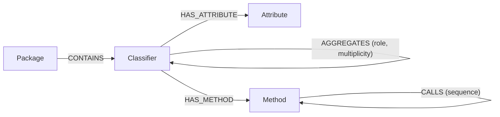

# Modelo do Grafo

Este documento descreve o esquema do grafo Neo4j que representa o diagrama de classes UML do sistema de e-commerce: labels de nó, tipos de relacionamento, propriedades, tipos de dado e o mapeamento dos conceitos UML para elementos do grafo.

## Esquema do grafo

## Nós

| Label | Tipo de label | Identificador único | Propriedades (tipo de dado) |
|---|---|---|---|
| `Package` | base | `name` | `name` (String) |
| `Classifier` | base | `id` | `id` (String), `name` (String), `kind` (String), `isAbstract` (Boolean) |
| `Class` | derivado de `Classifier.kind` | `id` (herdado de `Classifier`) | sem propriedades próprias |
| `Interface` | derivado de `Classifier.kind` | `id` (herdado de `Classifier`) | sem propriedades próprias |
| `Enum` | derivado de `Classifier.kind` | `id` (herdado de `Classifier`) | sem propriedades próprias |
| `Attribute` | base | `id` | `id` (String), `name` (String), `dataType` (String), `visibility` (String), `isStatic` (Boolean), `position` (Integer) |
| `Method` | base | `id` | `id` (String), `name` (String), `returnType` (String), `visibility` (String), `isStatic` (Boolean), `isAbstract` (Boolean), `position` (Integer) |

### Labels base e labels derivados

- **Labels base** (`Package`, `Classifier`, `Attribute`, `Method`) têm identificador único próprio, garantido por uma constraint de unicidade. Existem exatamente 4 constraints, uma por label base.
- **Labels derivados** (`Class`, `Interface`, `Enum`) são labels secundários aplicados a nós `Classifier` conforme o valor da propriedade `kind` (`class`, `interface` ou `enum`). Eles não têm identificador nem constraint próprios e usam o `id` do `Classifier`.
- Todo nó `Class`, `Interface` ou `Enum` também é um `Classifier`. Por isso, a contagem de `Classifier` é igual à soma das contagens de `Class`, `Interface` e `Enum`.
- Uma classe abstrata é um nó `Class` com `isAbstract = true`. `kind` não tem valor próprio para classe abstrata.

## Relacionamentos

| Tipo | Origem | Destino | Direção | Propriedades | Semântica UML |
|---|---|---|---|---|---|
| `CONTAINS` | `Package` | `Classifier` | Pacote para classificador | sem propriedades | pertencimento a pacote |
| `HAS_ATTRIBUTE` | `Classifier` | `Attribute` | Classificador para atributo | sem propriedades | atributo do classificador |
| `HAS_METHOD` | `Classifier` | `Method` | Classificador para método | sem propriedades | método do classificador |
| `EXTENDS` | `Classifier` | `Classifier` | Filho para pai | sem propriedades | herança |
| `IMPLEMENTS` | `Classifier` | `Classifier` | Classe para interface | sem propriedades | realização |
| `DEPENDS_ON` | `Classifier` | `Classifier` | Cliente para fornecedor | sem propriedades | dependência |
| `ASSOCIATES` | `Classifier` | `Classifier` | Origem para destino | `role` (String), `multiplicity` (String) | associação; a multiplicidade é a do lado destino |
| `COMPOSED_OF` | `Classifier` | `Classifier` | Todo para parte | `role` (String), `multiplicity` (String) | composição |
| `AGGREGATES` | `Classifier` | `Classifier` | Todo para parte | `role` (String), `multiplicity` (String) | agregação |
| `CALLS` | `Method` | `Method` | Chamador para chamado | `sequence` (Integer) | chamada de método |

## Mapeamento dos conceitos UML

| Conceito UML | Elemento correspondente no grafo |
|---|---|
| Classificador | Label `Classifier`, com label derivado `Class`, `Interface` ou `Enum` |
| Membro | Labels `Attribute` e `Method`, ligados ao classificador por `HAS_ATTRIBUTE` e `HAS_METHOD` |
| Relacionamento_UML | Tipos `EXTENDS`, `IMPLEMENTS`, `DEPENDS_ON`, `ASSOCIATES`, `COMPOSED_OF` e `AGGREGATES` |
| Chamada | Tipo `CALLS` |
| Pacote | Label `Package` e tipo `CONTAINS` |

## Convenções de nomenclatura

- Labels de nó em **PascalCase**: `Package`, `Classifier`, `Class`, `Interface`, `Enum`, `Attribute`, `Method`.
- Tipos de relacionamento em **UPPER_SNAKE_CASE**: `CONTAINS`, `HAS_ATTRIBUTE`, `HAS_METHOD`, `EXTENDS`, `IMPLEMENTS`, `DEPENDS_ON`, `ASSOCIATES`, `COMPOSED_OF`, `AGGREGATES`, `CALLS`.
- Propriedades em **camelCase**: `name`, `id`, `kind`, `isAbstract`, `dataType`, `visibility`, `isStatic`, `position`, `returnType`, `role`, `multiplicity`, `sequence`.
